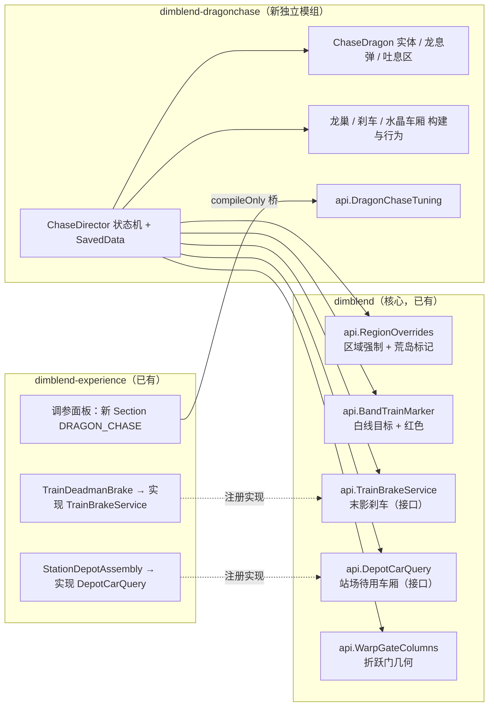

# Dragon Chase 实施计划（编排版）

> 需求口径：[requirements.md](file:///E:/misc/dimblend-wt-dragon-chase/dimblend-dragonchase/docs/requirements.md)（2026-11-13 定稿）。
> 工作区：worktree `E:\misc\dimblend-wt-dragon-chase`，分支 `crew/dragon-chase`（基于 master `f058373`）。
> 角色：我（编排者）负责共享契约、分派、每阶段一次性构建与测试、质检；实现由 agent-hub 子代理完成（`omp / clay/deepseek-flash / high`），审查用 `omp … / max` + `kimi k3.1-pro / max` 伴随核查。
> 提交：任何 `git commit` 都先报告、等你确认。

## 0. 两条待策划确认的假设（先按建议做，可逆）

| # | 假设 | 落点 |
|---|---|---|
| Q1 | 2 m/s 保底**不推**未挂进玩家列车的车站待用车厢 | W2 提供 `DepotCarQuery` 服务，W5 过滤 |
| Q2 | 车厢被硬推时，接触面已无玩家可破坏方块 → 停止啃，只被推着走 | W4 `CarriageCouplingEnforcer` |

策划回复不同意时，各改一处判断即可。

## 1. 架构

依赖方向（无环）：`dragonchase → dimblend`（compileOnly）；`experience → dragonchase api`（compileOnly，沿用 carwash 桥模式）；experience 的能力经 `dimblend.api` 服务接口暴露给 dragonchase，**dragonchase 不 import experience**，卸掉它不影响其余模组。

## 2. 共享契约（Phase 0，我内联完成）

1. **模块骨架**：`settings.gradle` 加 `dimblend-dragonchase`；`build.gradle`（照 carwash：Create、simurail/sable libs、sable-companion、copycats、`compileOnly project(':dimblend')`）；`gradle.properties`（`mod_id=dimblend_dragonchase`）；`neoforge.mods.toml`（依赖 dimblend、sable、simurail 为 required）；`DimBlendDragonChase` 主类 + `DragonChaseRegistries`（实体类型、音效复用原版）。
2. **dimblend.api 接口（空实现可编译）**：
   - `RegionOverrides`：`forceLane(MinecraftServer, int region, Override)`、`overrideOf(int region)`、`isBarren(int region)`；`Override { END_BARREN }`。
   - `BandTrainMarker`：`setOverride(@Nullable Marker)`，`Marker(double centerX, boolean alert)`。
   - `TrainBrakeService`：`boolean latch(ServerLevel, UUID carriage)`、`boolean isLatched(ServerLevel, UUID carriage)`；`register/get`。
   - `DepotCarQuery`：`boolean isIdleDepotCar(ServerLevel, UUID subLevel)`；`register/get`。
   - `WarpGateColumns`：`boolean touchesGate(ServerLevel, AABB worldBox)`（只读已加载区块）。
   - 消费方向：`purge.SableSubLevelsPurgedEvent`（`level` + 被删 Sable 子关卡 UUID 集合，`dimblend` 区域清理派发）。`carriage.CarPurgeListener` 把被清的 `CarRegistry` 记录标 `removed`，交给既有 `pruneRemoved` 收走；水晶车的水晶是世界坐标实体，可能落在相邻未清区域，故立即 `discard` 能取到的、其余 UUID 存进 `CarRegistry.orphanedCrystals` 等实体随区块加载加入世界时（`EntityJoinLevelEvent`）再丢。另有防护方向：`ChaseDirector.isNestForceLoadProtected` 经 `NonCrewCarriages.installUnticketGuard` 装给 `RegionSablePurger`，`WAITING`/`ACTIVE` 的龙巢整链不摘票（否则列车身后被卸载即自我放弃并烧掉该末地区域），`WON` 不保护、仍随区域清理；被清的龙巢由 `ChaseDirector` 既有「龙巢缺失超过载入宽限即 abandon」分支收尾，`DragonChaseSavedData` 无需额外处理。
3. **dragonchase 内部契约**（接口 + record，供 W3/W4/W5 并行）：
   - `entity.ChaseDragonControl`：`spawnPrologue / spawnChase / setAnchor(Vec3 nestPos, Vec3 trainPos) / requestFireball(Vec3 target) / requestBreath(Vec3 trackFrom, Vec3 trackTo) / beginSwoop(int ticks) / flyAway() / kill()`；回调 `DragonEvents`（`onDamaged(amount)`、`onFireballImpact(pos)`、`onDeathFinished`）。
   - `structure.CarBuilder`：`buildNest / buildBrakeCar / buildCrystalCar(ServerLevel, BlockPos center, double initialVx) → @Nullable ServerSubLevel`；`placeNestRewards(ServerLevel, ServerSubLevel nest, long seed)`。
   - `carriage.CarriageBehaviour`：`tick(ServerLevel)`、`register(ServerSubLevel car, CarKind)`、`fallAway(ServerSubLevel)`、`dissolve(ServerSubLevel)`；回调 `onCrystalsChanged(car, aliveCrystals)`。
   - `ChaseTuning` 值对象 + `api.DragonChaseTuning`（8 项，get/set 静态门面）。

## 3. 工作切片与文件归属（Phase 1，5 路并行）

| 切片 | 负责 | 独占文件（只改这些） | 不做 |
|---|---|---|---|
| **W1 核心改造** | 区域强制落盘与生效、荒岛生成、前方到达显示、白线覆盖与红色、折跃门几何 API | `dimblend/src/main/java/dimblend/api/{RegionOverrides,BandTrainMarker,WarpGateColumns}.java` 的实现体；`worldgen/BandLayout.java`、`worldgen/RotatingChunkGenerator.java`、`worldgen/RegionOverrideStore.java`(新)、`band/BandTrainLocator.java`、`band/BandTrainPayload.java`、`band/BandLaneSync.java`、`client/ClientBandTrain.java`、`client/BandProgressHud.java`；对应单测 | 不碰 experience / dragonchase |
| **W2 experience 接线** | 调参新 Section + 8 项 + 中英文 + 文档 + 协议号；`TrainBrakeService`、`DepotCarQuery` 实现与注册；核实车底 Y 锁不作用于本模组车厢（作用则加豁免） | `tuning/TuningOption.java`、`tuning/TuningSettings.java`、`tuning/TuningNetwork.java`、`tuning/DragonChaseTuningBridge.java`(新)、`client/TuningScreen.java`、`compat/simurail/TrainDeadmanBrake.java`、`compat/simurail/TrainBrakeServiceImpl.java`(新)、`chassis/StationDepotAssembly.java`、`chassis/DepotCarQueryImpl.java`(新)、`chassis/ChassisRailLock*.java`（仅需豁免时）、`lang/{zh_cn,en_us}.json`、`docs/parameter-tuning.md`、`build.gradle`、`TuningOptionTest` | 不碰 dimblend / dragonchase |
| **W3 龙** | `ChaseDragon`（继承原版末影龙取模型/动画/声音，整段重写 `aiStep`，不破坏方块、不掉经验）；序章/追逐飞行（盘旋、对齐龙巢 ±32/±16、俯冲 10 秒、离场 45° 爬升）；每秒 2% 掉血上限与受击提示；Boss 条名；龙息弹（定点命中、爆炸声、无伤害无云）；吐息动画+轨道龙息区粒子；水晶回血（每颗 1/s、不限距离、光束）；客户端渲染注册 | `dragonchase/entity/**`、`dragonchase/client/**` | 不决定何时出招（W5 调用） |
| **W4 车厢** | 三种结构布局与构建（伪装梁/台阶材质：紫珀、黑曜石、末地石砖、上浅层/下深层红石矿）；转向架参数「启用/禁止/禁止/禁止/刹车/0.0/可见」；红石块+灯充能刷新；末影水晶放置并随车；红石粒子/黑烟/白烟；车架不可调；硬推时啃玩家可破坏方块（Q2）；坠落销毁（毁自身车钩不掉落→关转向架→±Z 45° 弹飞→爆炸粒子音效→删除）；奖励车厢式消散；龙死奖励（金属块 20 格、潜影盒 27 格） | `dragonchase/structure/**`、`dragonchase/carriage/**` | 不决定何时生成（W5 调用） |
| **W5 导演** | `ChaseDirector` 状态机与 `DragonChaseSavedData`；序章触发（每世界一次、256/1536/受伤/<1 m/s）；龙巢触发（34+ 末地、邻区非末地、列车进区、区块就绪后放 512）；2 m/s 保底（全常加载，排除 Q1，刹车锁存时暂停）；保持 128 格与最低速度公式/增长/上限；失败距离；越 1024 强制下一区荒岛末地（仅追逐中）；伤害累计→龙息弹→生成车厢（50/50，比列车慢 5 m/s）；60/40/25/10 吐息与穿越触发末影刹车；龙死后流程与世代+1；折跃门消散；成就发放（解放末地/结束了…再一次…）；追逐期间龙巢 256 格内禁自然刷怪；重进存档 10 秒缓冲；Config 与 `api.DragonChaseTuning`；调试命令 `/dragonchase`（op）；纯函数单测 | `dragonchase/DimBlendDragonChase.java`(补全)、`dragonchase/Config.java`、`dragonchase/api/**`、`dragonchase/chase/**`、`dragonchase/command/**`、`dragonchase/src/test/**` | 不写实体/结构内部 |

串行依赖：W3/W4/W5 只依赖 Phase 0 契约，可并行；W5 的实机行为依赖 W1（区域强制）与 W2（刹车服务），用接口隔离，编译不阻塞。

每个子代理简报都写明：只改自己名下文件、**不跑构建/测试/格式化**、源码取证按 `dimblend-dev` §3（本机源码优先、写文件:行号）、不 commit。

## 4. 阶段与质检门

| 阶段 | 内容 | 门（我来跑，一次性） |
|---|---|---|
| P0 | 契约与骨架（内联） | `gradlew :dimblend-dragonchase:compileJava :dimblend:compileJava` 绿 |
| P1 | W1–W5 并行实现 | 全量 `gradlew build`（8+1 模块编译+单测）；数单测 XML；读 diff 对照归属表，越界改动退回 |
| P2 | 审查 | `omp max` 对照 requirements.md 逐条审查 + `kimi max` 伴随查漏；问题按切片退回原 worker 修，再跑 P1 门 |
| P3 | GameTest | dragonchase GameTest：三种车厢组装/转向架参数/充能、奖励填充、区域强制后生成荒岛、龙巢保持距离数学；`runGameTestServer` 看 `All N required tests passed :)` |
| P4 | 实机（TrainTripWorld） | 先查本机负载再启动；部署 jar（备份旧 jar）；用 `/dragonchase` 调试命令走完：序章 → 进区放巢 → 追逐 → 龙息弹两种车厢 → 吐息刹车 → 击杀奖励 → 带出末地消散 → 失败分支；看 TPS、按 §4.6 数日志重复行；优雅退出 |
| P5 | 收尾 | 汇报改动文件/风险/建议提交信息，等你确认后提交；`dimblend-dev` skill 回写可复用经验 |

## 5. 主要技术风险与应对

| 风险 | 应对 |
|---|---|
| 原版末影龙 `aiStep` 含相位 AI、破坏方块、部件定位 | W3 继承但不调用 `super.aiStep()`，自行更新部件位置与 `tickDeath`（取消经验），用原版源码 `E:\misc\mcsrc-1.21.1` 逐行取证 |
| 末影水晶实体随车移动（Sable 是否带动实体） | W4 先取证 sable 实体跟随机制；不支持则每 tick 按车厢位姿重定位并同步 |
| 坠落弹飞被转向架轨道约束或车底 Y 锁挡住 | 弹飞前关转向架；W2 核实 `ChassisRailLock` 范围，必要时加豁免 |
| 区域强制晚于区块生成造成接缝 | 越 1024 即落盘（距边界 1024 格）；若边界区块已加载则记 WARN |
| 荒岛生成与 32 m/s 下的区块压力 | 荒岛 = 固定 `end_barrens` 群系 + 跳过装饰/结构/原生刷怪；P4 实测 TPS |
| 水晶原版爆炸炸坏车架导致脱轨 | P4 实测车架/车钩/底盘爆炸抗性；不足时报告给策划再定 |
| 运行期往龙巢 plot 写奖励方块 | W4 取证 sable plot 写入路径（与玩家在车上放方块同路径） |
